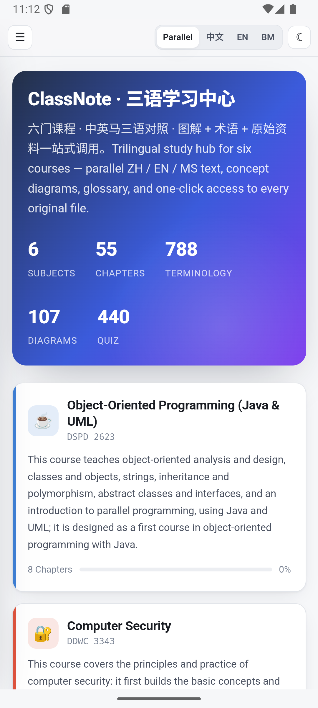
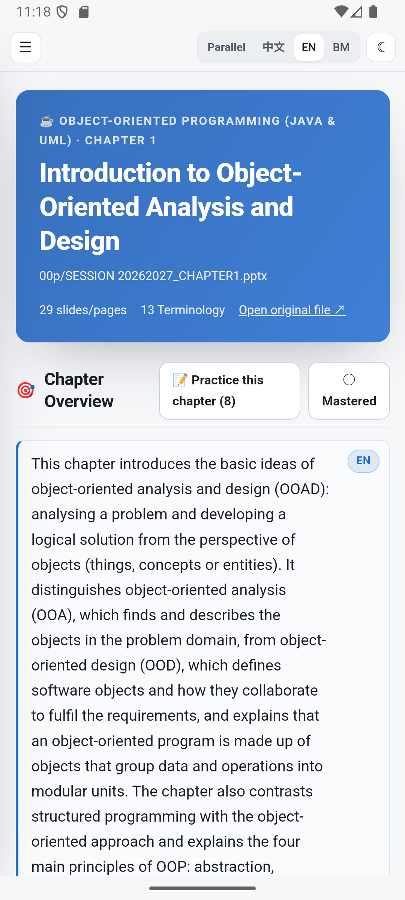
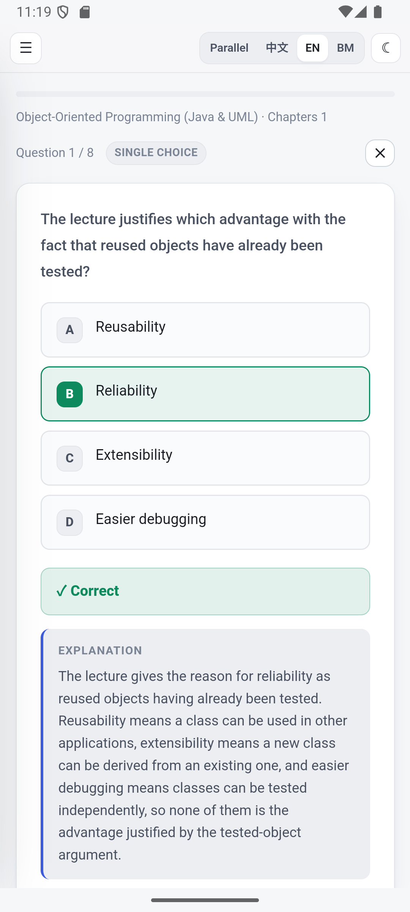

# ClassNote · 三语学习中心

六门大学课程的中英马三语对照学习站，外加一个把它装进手机的 Android App。
全部内容离线可用，纯静态、零依赖。



## 功能

| 模块 | 说明 |
|---|---|
| 章节 | 55 章，概述 / 核心要点 / 三语对照正文，每章附原始讲义逐页文字 |
| 图解 | 107 张结构化 SVG 图解（layers / flow / cycle / tree / compare / matrix / timeline），切换语言自动重绘 |
| 术语 | 788 条三语术语总表，可按科目筛选、检索 |
| 题库 | 440 道题（单选 / 多选 / 判断 / 填空），即时判分 + 三语解析 + 错题本 |
| 资料库 | 全部原始讲义文件索引，一键打开 |
| 搜索 | 全站检索章节、要点、术语、考点 |
| 编程实验室 | 写代码 → 本机真编译（Java / VB.NET）→ 跑测试用例 |

六门课：OOP (Java + UML)、Computer Security、Data Communication and Networking、
Operating Systems、Systems Analysis and Design Methods、Visual Basic .NET。

## 在线使用

在仓库 **Settings → Pages** 里选择 `main` 分支的 `/(root)`，即可直接用浏览器打开。
也可以本地双击 `index.html`。

## 目录结构

```
index.html               网站入口
assets/css/app.css       样式（浅色 / 深色）
assets/js/app.js         路由、三语切换、搜索、各页面视图
assets/js/diagram.js     图解渲染引擎
assets/js/quiz.js        练习引擎
assets/js/code.js        编程实验室前端
data/                    三语内容、题库、编程题、原始讲义文字
_tools/                  数据校验脚本
server.js                编程实验室的本地编译服务（仅标准库）
android/                 Android 工程（WebView 壳）
tools/sync-assets.ps1    把网站同步进 App 的 assets
docs/screenshots/        应用截图
```

## Android App

| 项 | 值 |
|---|---|
| 包名 | `com.classnote.app` |
| 版本 | 1.0 |
| minSdk / targetSdk / compileSdk | 26 / 37 / 37 |
| 构建 | AGP 9.5.2 + Gradle 9.7.1 + JDK 17 |

构建步骤：

```powershell
# 1) 把网站拷进 App 的 assets（assets 不入库，构建前必须执行一次）
powershell -ExecutionPolicy Bypass -File tools\sync-assets.ps1

# 2) 打包
cd android
.\gradlew.bat :app:assembleDebug
```

产物：`android/app/build/outputs/apk/debug/app-debug.apk`

| 版本 | 体积 | 说明 |
|---|---|---|
| 完整版 | ≈139 MB | 内嵌全部原始讲义 PDF/PPTX，「打开原文件」可用 |
| 精简版 | ≈7 MB | 不含讲义二进制，其余功能完整 |

实现要点：

- WebView + `shouldInterceptRequest` 在虚拟 https 源 `appassets.androidplatform.net` 上提供 assets，
  避免 `file://` 下 localStorage / 模块脚本的各种坑。
- 「打开原文件」把 PDF/PPTX 从 assets 复制到 cache，经 `FileProvider` 交给 WPS / Office / Drive。
- 返回键：先收侧边栏 → 再网页后退 → 最后退出（Android 13+ 用 `OnBackInvokedDispatcher`）。
- Edge-to-edge 下用 WindowInsets 给状态栏 / 手势条让位。

手机端适配（已合入本站 CSS/JS）：

- ≤640px 顶栏改为单行：☰ + 语言切换 + 主题，隐藏面包屑与打印按钮；
- 资料库行允许换行，文件名不再被压成一列一个字；
- 点抽屉外区域或路由切换时自动收起侧边栏；
- `text-size-adjust:100%` 防止 WebView 二次放大文字。




## 说明

- 仓库**不包含** `00p/ cs/ dcn/ os/ sadm/ vb/` 六个原始讲义目录（版权与体积原因）。
  把讲义放回对应目录即可让「资料库 → 打开原文件」恢复；站内正文（`data/raw/`）不受影响。
- 编程实验室需要本机 `node` + JDK / .NET SDK，手机端只显示离线提示。
- 课程原始讲义版权归原作者与学校所有。

## 重建内容数据

```powershell
python _tools\extract.py     # 从讲义抽文字
python _tools\split.py
python _tools\genraw.py
python _tools\gensubj.py
node _tools\validate.js <科目>
node _tools\validate-quiz.js <科目>
```
